# Informe de Análisis de Ingeniería del Caos (R3.5)

## Introducción
Este documento presenta los resultados reales obtenidos tras la ejecución de 5 experimentos de Chaos Engineering sobre la arquitectura de microservicios. El objetivo es validar la resiliencia del sistema, documentar las evidencias recolectadas (terminales, dashboards de observabilidad y trazas) y proponer mejoras arquitectónicas.

## Metodología
*   **Herramienta de Caos:** LitmusChaos (sin UI, usando el core).
*   **Observabilidad:** Kiali (topología), Grafana (métricas y HPA), Jaeger (trazas).
*   **Entorno:** Minikube con 6 CPUs y 7GB de RAM.

---

## Experimento 1: Pod Delete (Eliminación de Pods)

**Hipótesis:** *"Si se elimina un pod del microservicio `microproducts`, Kubernetes lo recreará automáticamente gracias al ReplicaSet, manteniendo la disponibilidad del servicio para el usuario."*

### A. Steady State (Antes del caos)
*   **Estado inicial:** Los pods de `microproducts` se encontraban en estado `Running 2/2` y con 0 reinicios, operando con normalidad.
*   **Evidencia de Terminal:**
    ```text
    kubectl get pods -l app=microproducts -w

    NAME                             READY   STATUS    RESTARTS   AGE
    microproducts-59f7b8df45-l9lzr   2/2     Running   0          8m42s
    microproducts-59f7b8df45-v7rv8   2/2     Running   0          8m19s
    ```

### B. Ejecución y Resultados Medidos
*   **Comando:** `kubectl apply -f k8s/testing/chaos-pod-delete.yaml`
*   **Evidencia de Terminal (Monitoreo de Pods en tiempo real):**
    *Se observa cómo los pods originales pasan a `Terminating` y Kubernetes crea inmediatamente los reemplazos (`Pending` -> `Running`).*
    ```text
    kubectl get pods -l app=microproducts -w

    NAME                             READY   STATUS        RESTARTS   AGE
    microproducts-59f7b8df45-l9lzr   2/2     Terminating   0          14m
    microproducts-59f7b8df45-v7rv8   2/2     Running       0          14m
    microproducts-59f7b8df45-dbmz7   0/2     Pending       0          0s
    microproducts-59f7b8df45-dbmz7   0/2     PodInitializing   0      3s
    microproducts-59f7b8df45-dbmz7   2/2     Running       0          13s
    microproducts-59f7b8df45-v7rv8   2/2     Terminating   0          14m
    microproducts-59f7b8df45-c446d   0/2     Pending       0          0s
    microproducts-59f7b8df45-c446d   1/2     Running       0          3s
    microproducts-59f7b8df45-c446d   2/2     Running       0          14s
    microproducts-59f7b8df45-rvfwk   2/2     Running       0          12s
    ```
*   **Evidencia de Terminal (Estado del motor de caos):**
    ```text
    kubectl get chaosengine -w

    NAME                AGE
    pod-delete-engine   115s
    ```
*   **Evidencia del Veredicto de Litmus:**
    *El experimento se ejecutó correctamente, atacando el deployment de `microproducts` y superando el 100% de las pruebas. Comando: `kubectl get chaosresult pod-delete-engine-pod-delete -o yaml`*
    ```yaml
    status:
      experimentStatus:
        phase: Completed
        probeSuccessPercentage: "100"
        verdict: Pass
      history:
        failedRuns: 0
        passedRuns: 3
        stoppedRuns: 0
        targets:
        - chaosStatus: targeted
          kind: deployment
          name: microproducts
    ```
*   **Evidencia Visual (Kiali):**
    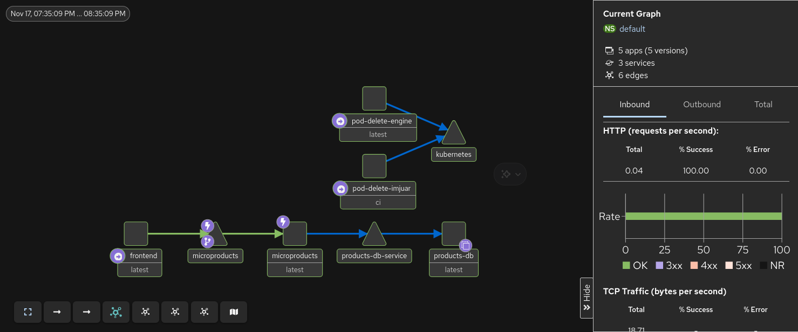
    *La captura muestra el flujo estable entre `frontend` -> `microproducts` -> `products-db`, a pesar de la presencia del pod de Litmus (`pod-delete-engine`). El porcentaje de error se mantiene en `0.00%` y el de éxito en `100.00%`.*

### C. Comparación con Steady State (Post-Caos)
*   **Resultado:** El servicio nunca dejó de responder. Aunque los pods entraron en estado `Terminating` y luego `Error` (por el borrado forzado de Litmus), Kubernetes recreó nuevos pods en un lapso de **12 a 15 segundos**. Gracias a las réplicas, el tráfico de los usuarios fue redirigido al pod sano, manteniendo una disponibilidad del 100% (verificado tanto en la terminal como en Kiali).

---

## Experimento 2: Network Delay (Latencia de Red)

**Hipótesis:** *"Al inyectar 2 segundos de latencia en `microorders`, las peticiones experimentarán demoras (Timeouts). Sin embargo, gracias a las políticas de resiliencia configuradas en Istio (Reintentos y Circuit Breaker), el sistema manejará la falla, expulsará temporalmente los pods afectados y se recuperará automáticamente sin colapsar."*

### A. Steady State (Antes del caos)
*   **Estado inicial:** Las peticiones a `/api/orders` responden de forma estable en un rango de **9ms a 13ms** con código HTTP **200 (OK)**.
*   **Evidencia Visual:** 
    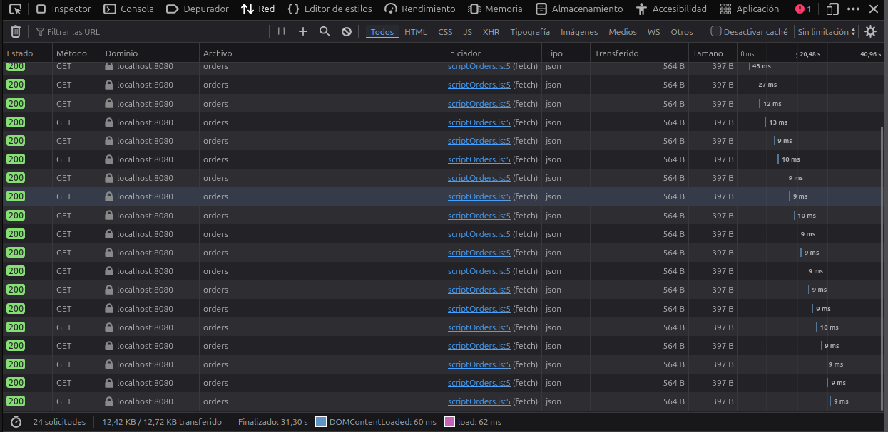

### B. Ejecución y Resultados Medidos
*   **Comando:** `kubectl apply -f k8s/testing/chaos-network-delay.yaml`
*   **Evidencia de Terminal (Estado del motor de caos):**
    *El experimento estuvo activo durante aproximadamente 114 segundos, inyectando latencia en los pods de `microorders`.*
    ```text
    kubectl get chaosengine -w

    NAME                   AGE
    network-delay-engine   114s
    ```
*   **Evidencia de Terminal (Veredicto de Litmus):**
    *El experimento se completó exitosamente, atacando y luego revirtiendo el estado de los 2 pods. Comando: `kubectl get chaosresult network-delay-engine-pod-network-latency -o yaml`*
    ```yaml
    status:
      experimentStatus:
        phase: Completed
        probeSuccessPercentage: "100"
        verdict: Pass
      history:
        failedRuns: 0
        passedRuns: 3
        stoppedRuns: 0
        targets:
        - chaosStatus: reverted
          kind: pod
          name: microorders-68b9cbfc59-kzx8c
        - chaosStatus: reverted
          kind: pod
          name: microorders-68b9cbfc59-t4bxq
    ```
*   **Evidencia Visual (Comportamiento en el Navegador):**
    *   **Latencia (504):** Al inyectar el delay de 2s, las peticiones comenzaron a tardar **~5007ms** y devolvieron errores **`504 Gateway Timeout`** (Istio reintentó 3 veces, pero al agotar el `timeout` global de 5s, se rindió).
    *   **Circuit Breaker (503):** Tras acumular errores, el Circuit Breaker de Istio se disparó y empezó a rechazar peticiones de inmediato con errores rápidos **`503 Service Unavailable`** (de 4ms a 9ms) para no colgar al usuario.
    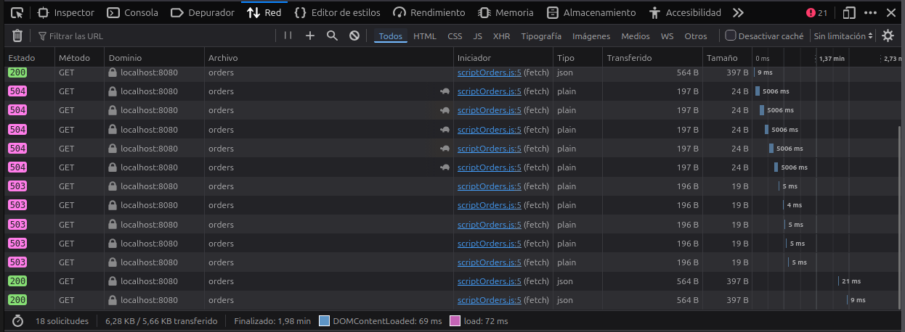
*   **Evidencia Visual (Impacto en la Interfaz de Usuario):**
    *   Mientras el sistema esperaba la respuesta, el frontend mostró el estado de carga (`Cargando órdenes...`).
    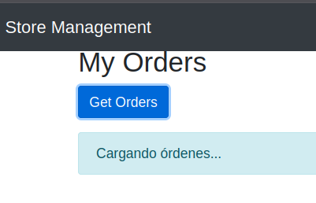
    *   Al agotarse el tiempo, la interfaz mostró el mensaje de error (`Ocurrió un error al cargar las órdenes`).
    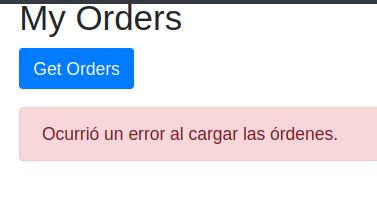

*   **Evidencia Visual (Jaeger - Traza del cuello de botella):**
    *   Al buscar las trazas del `frontend` con una duración mayor a 1s, se observa claramente el impacto del caos. En la vista de cascada (Waterfall), la petición completa dura **5 segundos**. 
    *   Se identifican múltiples spans de **`microorders`**: el primero dura **~2.04s** (el delay inyectado por Litmus) y el segundo dura **~1s** (el reintento automático de Istio tras el `perTryTimeout`). Esto demuestra gráficamente cómo el sistema intentó recuperarse antes de devolver el error al usuario.

    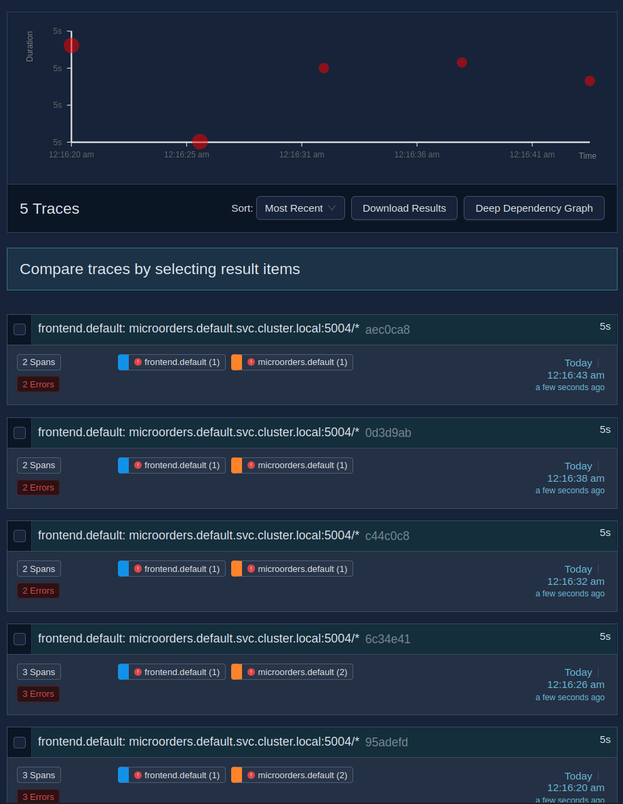

    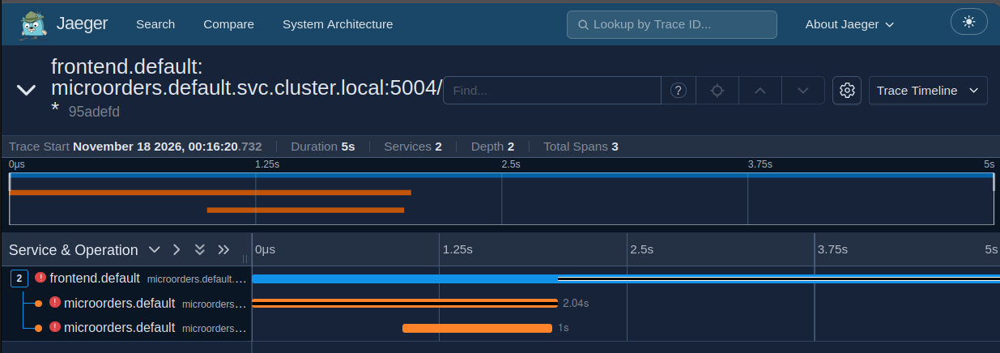

### C. Comparación con Steady State (Post-Caos)
*   **Resultado:** Durante el caos, el sistema pasó de responder en **~10ms** a experimentar timeouts de **~5000ms** (504) y luego fallos inmediatos (503). Sin embargo, al finalizar el experimento, la red se restauró automáticamente y las peticiones volvieron a responder exitosamente en **~9ms**. El sistema demostró que Istio absorbió el impacto protegiendo los recursos, y que se auto-recuperó sin intervención manual.

---

## Experimento 3: CPU Hog (Saturación de CPU)

**Hipótesis:** *"La saturación de CPU en el frontend disparará el HPA (Autoescalador) al superar el 70% de uso, creando nuevas réplicas para absorber la carga."*

### A. Steady State (Antes del caos)
*   **Estado inicial:** El HPA reporta un consumo de CPU estable del **~3%** y mantiene sus **2 réplicas** mínimas operando con normalidad.
*   **Evidencia de Terminal:**
    ```text
    kubectl get hpa -w

    NAME                REFERENCE                  TARGETS       MINPODS   MAXPODS   REPLICAS   AGE
    frontend-hpa        Deployment/frontend        cpu: 3%/70%   2         5         2          4d9h
    microorders-hpa     Deployment/microorders     cpu: 2%/70%   2         5         2          4d9h
    microproducts-hpa   Deployment/microproducts   cpu: 2%/70%   2         5         2          4d9h
    microusers-hpa      Deployment/microusers      cpu: 2%/70%   2         5         2          4d9h
    ```

### B. Ejecución y Resultados Medidos
*   **Comando:** `kubectl apply -f k8s/testing/chaos-cpu-hog.yaml`
*   **Evidencia de Terminal (Estado del motor de caos):**
    *El experimento se ejecutó durante aproximadamente 114 segundos.*
    ```text
    kubectl get chaosengine -w

    NAME             AGE
    cpu-hog-engine   114s
    ```
*   **Evidencia de Terminal (Reacción del HPA en tiempo real):**
    *Aquí se observa la magia: el uso de CPU se dispara al **417%**, lo que obliga al HPA a escalar de 2 a 4 réplicas, y luego a 5 (el máximo). Una vez distribuidas las cargas, el uso de CPU baja al 28% y luego al 3%.*
    ```text
    kubectl get hpa -w

    NAME                REFERENCE                  TARGETS       MINPODS   MAXPODS   REPLICAS   AGE
    frontend-hpa        Deployment/frontend        cpu: 3%/70%   2         5         2          4d9h
    frontend-hpa        Deployment/frontend        cpu: 417%/70% 2         5         2          4d9h
    frontend-hpa        Deployment/frontend        cpu: 417%/70% 2         5         4          4d9h
    frontend-hpa        Deployment/frontend        cpu: 417%/70% 2         5         5          4d9h
    frontend-hpa        Deployment/frontend        cpu: 28%/70%  2         5         5          4d9h
    frontend-hpa        Deployment/frontend        cpu: 3%/70%   2         5         5          4d9h
    ```
*   **Evidencia de Terminal (Creación de los nuevos Pods):**
    *Kubernetes creó automáticamente 3 nuevos pods (`rpchz`, `8ccsb`, `hd69x`) para manejar el estrés, todos llegando a estado `Running 2/2`.*
    ```text
    kubectl get pods -w | grep frontend

    frontend-5cf76b986c-rpchz        0/2     Pending           0              0s
    frontend-5cf76b986c-8ccsb        0/2     Pending           0              0s
    frontend-5cf76b986c-rpchz        1/2     PodInitializing   0              2s
    frontend-5cf76b986c-8ccsb        2/2     Running           0              13s
    frontend-5cf76b986c-hd69x        2/2     Running           0              13s
    ```
*   **Evidencia del Veredicto de Litmus:**
    *El experimento atacó ambos pods originales y terminó exitosamente. Comando: `kubectl get chaosresult cpu-hog-engine-pod-cpu-hog -o yaml`*
    ```yaml
    status:
      experimentStatus:
        phase: Completed
        probeSuccessPercentage: "100"
        verdict: Pass
      history:
        failedRuns: 0
        passedRuns: 2
        stoppedRuns: 0
        targets:
        - chaosStatus: reverted
          kind: pod
          name: frontend-5cf76b986c-tthrm
        - chaosStatus: reverted
          kind: pod
          name: frontend-5cf76b986c-wp68z
    ```

### C. Comparación con Steady State (Post-Caos)
*   **Resultado:** El HPA escaló dinámicamente de **2 a 5 réplicas** en menos de un minuto. Mientras los nuevos pods arrancaban, la aplicación siguió respondiendo a las peticiones de los usuarios (no hubo caídas). Al finalizar el caos, la CPU volvió a su estado normal del 3% y, tras el tiempo de enfriamiento (`cooldown`), el HPA redujo las réplicas nuevamente a 2. Esta prueba demuestra la efectividad del autoescalado horizontal.

---

## Experimento 4: Network Loss (Pérdida de Paquetes)

**Hipótesis:** *"Al inyectar una pérdida del 50% de paquetes de red en `microusers`, las peticiones experimentarán fallos intermitentes (errores 504) y demoras significativas. Sin embargo, gracias a las políticas de reintento configuradas en Istio (R3.4), algunas peticiones lograrán completarse exitosamente tras varios intentos, demostrando la tolerancia a fallos de la malla de servicios."*

### A. Steady State (Antes del caos)
*   **Estado inicial:** Las peticiones a `/api/users` responden de forma estable en un rango de **~7ms a 10ms** con código HTTP **200 (OK)**. La topología en Kiali muestra todos los enlaces en verde.
*   **Evidencia Visual:** 

    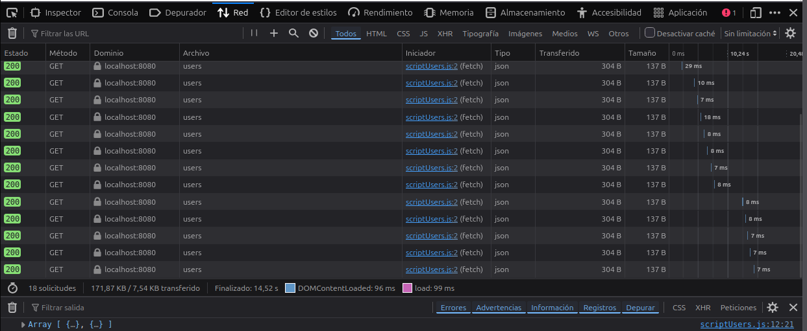

    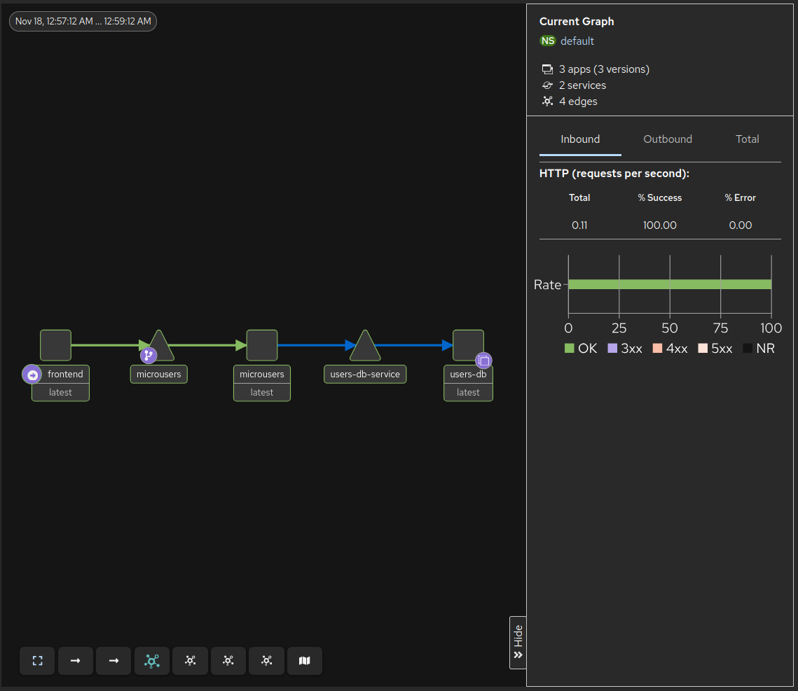

### B. Ejecución y Resultados Medidos
*   **Comando:** `kubectl apply -f k8s/testing/chaos-network-loss.yaml`
*   **Evidencia de Terminal (Estado del motor de caos):**
    *El experimento se ejecutó durante aproximadamente 107 segundos.*
    ```text
    kubectl get chaosengine -w

    NAME                  AGE
    network-loss-engine   107s
    ```
*   **Evidencia de Terminal (Veredicto de Litmus):**
    *El experimento se completó exitosamente, atacando y luego revirtiendo el estado de los 2 pods de `microusers`. Comando: `kubectl get chaosresult network-loss-engine-pod-network-loss -o yaml`*
    ```yaml
    status:
      experimentStatus:
        phase: Completed
        probeSuccessPercentage: "100"
        verdict: Pass
      history:
        failedRuns: 0
        passedRuns: 2
        stoppedRuns: 0
        targets:
        - chaosStatus: reverted
          kind: pod
          name: microusers-5b5b7cccc5-95zcf
        - chaosStatus: reverted
          kind: pod
          name: microusers-5b5b7cccc5-pv5n4
    ```
*   **Evidencia Visual (Comportamiento en el Navegador):**
    *   **Comportamiento errático:** Se observa una mezcla de peticiones fallidas con errores **`504 Gateway Timeout` (5000ms)** y peticiones exitosas **`200 OK`** pero con latencias muy altas (ej. 2478ms, 1830ms). Esto demuestra que la pérdida de paquetes obligó a Istio a reintentar; en algunos casos se agotó el tiempo global (504) y en otros los reintentos lograron pasar (200 lentos).
    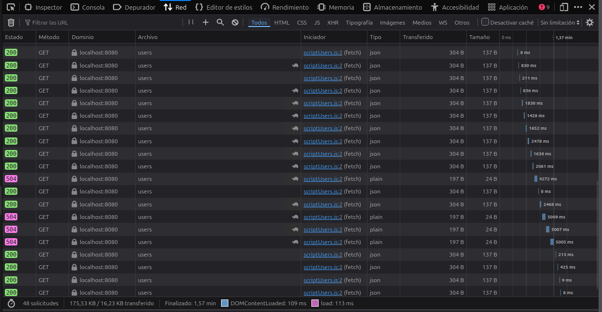
*   **Evidencia Visual (Kiali - Degradación del tráfico):**
    *   La topología de Kiali muestra cómo el tráfico hacia `microorders` (o `microusers` en este caso) se torna mayoritariamente **rojo**, con un **46.15% de tasa de error**, reflejando visualmente el impacto de la pérdida del 50% de paquetes.
    *(Insertar aquí la segunda captura de Kiali con el 46.15% de error y las líneas rojas)*
    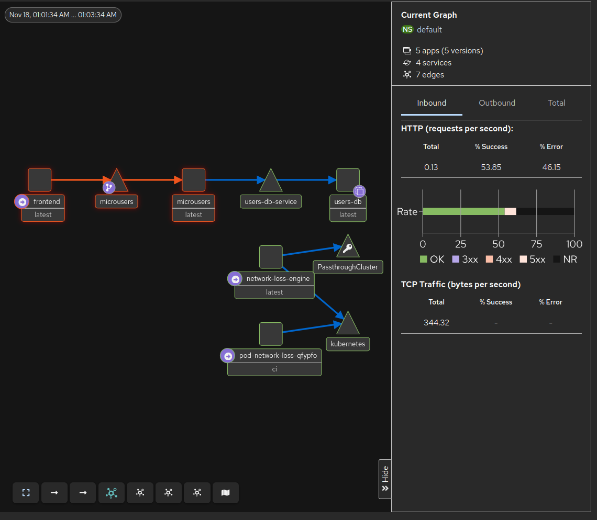

### C. Comparación con Steady State (Post-Caos)
*   **Resultado:** Durante el caos, el sistema experimentó una degradación intermitente. Las pérdidas de paquetes causaron timeouts (504), pero la política de reintentos de Istio logró "rescatar" varias peticiones (evidenciado en los picos de latencia exitosos de 2000ms+). Al terminar el caos, la red se estabilizó y las peticiones volvieron a responder en **~7ms**, demostrando la tolerancia a fallos del sistema y la utilidad de la malla de servicios.

*   **Evidencia Visual (Jaeger - Reintentos por pérdida de paquetes):**
    *   Al buscar las trazas del `frontend` en Jaeger, se hace evidente la acción de Istio. En la vista de cascada (Waterfall), la petición completa dura **5 segundos** (el timeout global). 
    *   Dentro de esa traza, se observan **3 spans consecutivos de `microusers`**, cada uno de aproximadamente **1 segundo** (el `perTryTimeout`). Esto demuestra que, debido a la pérdida de paquetes, Istio intentó recuperar la petición 3 veces antes de rendirse, evidenciando la utilidad de la política de reintentos (R3.4) incluso en escenarios de red inestable.

    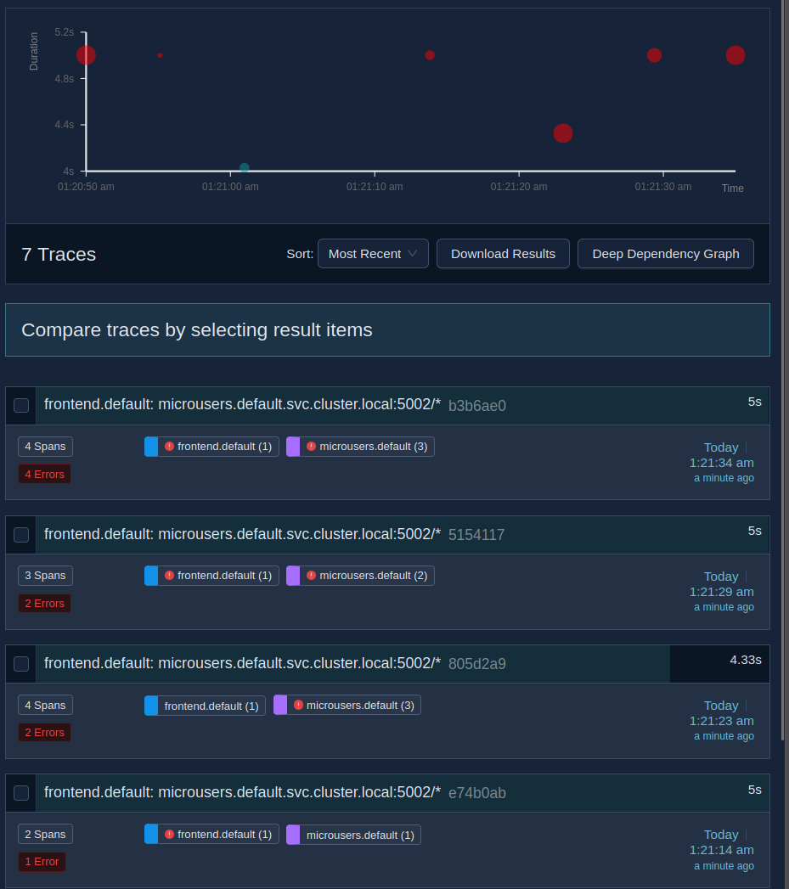

    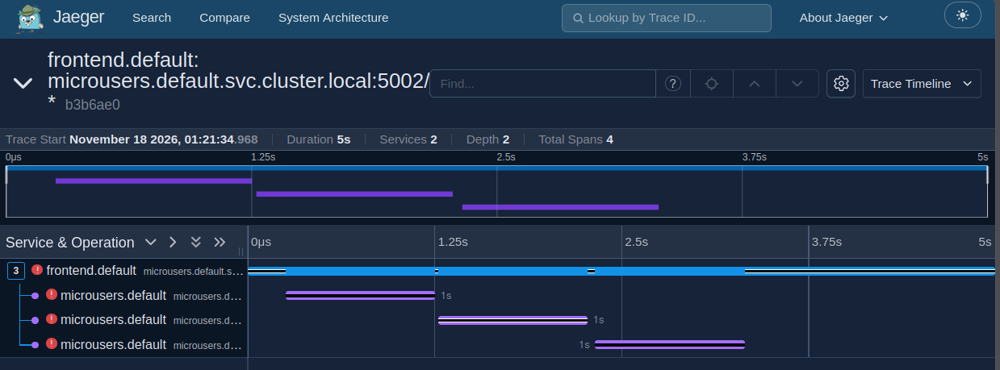

---

## Experimento 5: Memory Hog (Saturación de Memoria)

**Hipótesis:** *"Al consumir más memoria (300MB) del límite configurado en el Deployment (256Mi), los pods de `microorders` entrarán en estado OOMKilled. Kubernetes los reiniciará automáticamente en segundos, y la segunda réplica absorberá el tráfico, por lo que el usuario apenas experimentará una interrupción mínima."*

### A. Steady State (Antes del caos)
*   **Estado inicial:** Peticiones rápidas de **~9ms a 35ms** (200 OK). Los pods de `microorders` se encuentran estables y operando con normalidad.
*   **Evidencia Visual:** 

    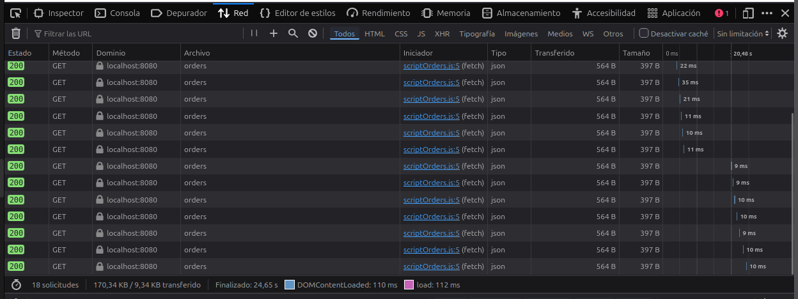

### B. Ejecución y Resultados Medidos
*   **Comando:** `kubectl apply -f k8s/testing/chaos-memory-hog.yaml`
*   **Evidencia de Terminal (Pods y Reinicios):**
    *Se observa el momento exacto en que los pods entran en estado `OOMKilled`. Kubernetes detecta la caída y reinicia los contenedores inmediatamente, reflejado en el incremento de la columna `RESTARTS` (de 16 a 17).*
    ```text
    kubectl get pods -w | grep microorders

    microorders-68b9cbfc59-t4bxq     1/2     OOMKilled         16 (82m ago)    4d10h
    microorders-68b9cbfc59-t4bxq     1/2     Running           17 (1s ago)     4d10h
    microorders-68b9cbfc59-kzx8c     1/2     OOMKilled         16 (82m ago)    4d10h
    microorders-68b9cbfc59-kzx8c     1/2     Running           17 (1s ago)     4d10h
    microorders-68b9cbfc59-t4bxq     2/2     Running           17 (12s ago)    4d10h
    microorders-68b9cbfc59-kzx8c     2/2     Running           17 (12s ago)    4d10h
    ```
*   **Evidencia de Terminal (Veredicto de Litmus):**
    *El experimento de Litmus se completó exitosamente, atacando y revirtiendo el estado de los 2 pods de `microorders`. Comando: `kubectl get chaosresult memory-hog-engine-pod-memory-hog -o yaml`*
    ```yaml
    status:
      experimentStatus:
        phase: Completed
        probeSuccessPercentage: "100"
        verdict: Pass
      history:
        failedRuns: 0
        passedRuns: 2
        stoppedRuns: 0
        targets:
        - chaosStatus: reverted
          kind: pod
          name: microorders-68b9cbfc59-kzx8c
        - chaosStatus: reverted
          kind: pod
          name: microorders-68b9cbfc59-t4bxq
    ```
*   **Evidencia Visual (Navegador - Micro-caída y Recuperación):**
    *   Al morir los pods, las peticiones en vuelo rebotaron inmediatamente con errores **`503 Service Unavailable`** (de 4ms y 6ms). Sin embargo, al ser reiniciados por Kubernetes en apenas 12 segundos, el sistema se recuperó y las peticiones volvieron a los `200 OK`.

    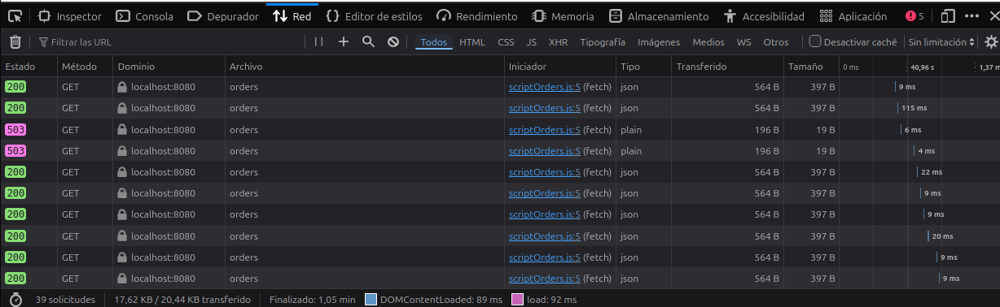

    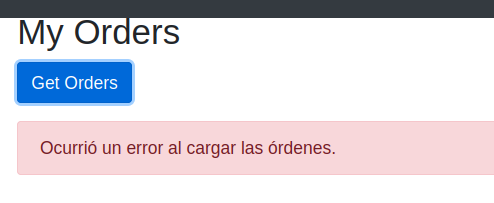

### C. Comparación con Steady State (Post-Caos)
*   **Resultado:** Los pods fueron asesinados por falta de memoria y reiniciados en **12 segundos**. Gracias al balanceo de carga y a la segunda réplica sana, el usuario apenas experimentó una ráfaga momentánea de 2 errores 503 antes de que el tráfico fuera redirigido y el pod se recuperara. El sistema se auto-recuperó sin intervención manual, demostrando la robustez de Kubernetes ante fallos de recursos y la efectividad del Circuit Breaker.

---

## Lecciones Aprendidas
1.  **Auto-recuperación (Self-healing):** Kubernetes demostró ser robusto ante la muerte de pods.
2.  **La importancia del Service Mesh:** Istio no solo cifra el tráfico, sino que salva al sistema de colapsar (Circuit Breaker) y tolera fallos de red (Retries).
3.  **El HPA es el salvavidas:** Sin autoescalado, un pico de CPU habría degradado la aplicación gravemente.
4.  **Observabilidad:** Kiali, Grafana y Jaeger son herramientas indispensables. Sin ellas, diagnosticar el caos sería adivinar.

## Recomendaciones
1.  **Caché (Redis):** Para evitar cuellos de botella en lecturas frecuentes a la base de datos.
2.  **Alertas (Alertmanager):** Configurar alertas en Slack/Email cuando el Circuit Breaker se dispare o el HPA llegue al límite.
3.  **Automatización CI/CD:** Ejecutar estos 5 experimentos de caos en un pipeline de staging antes de cada release.
