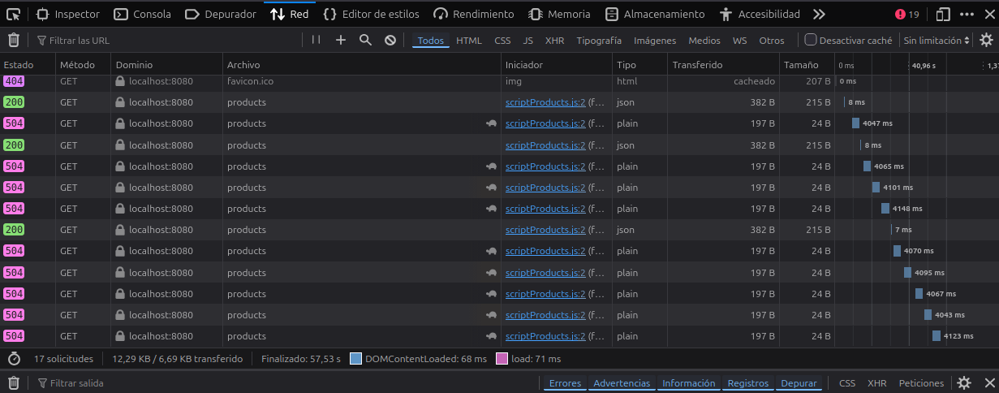
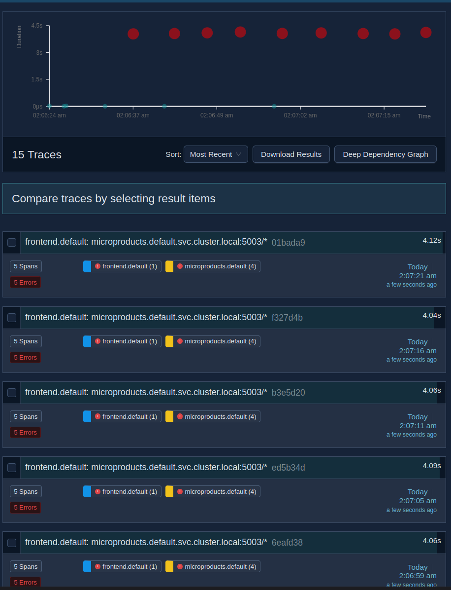
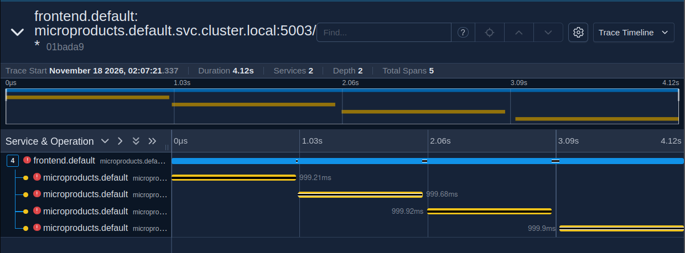
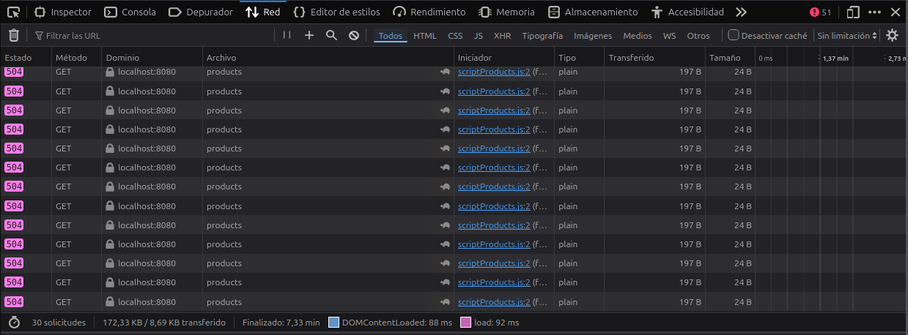
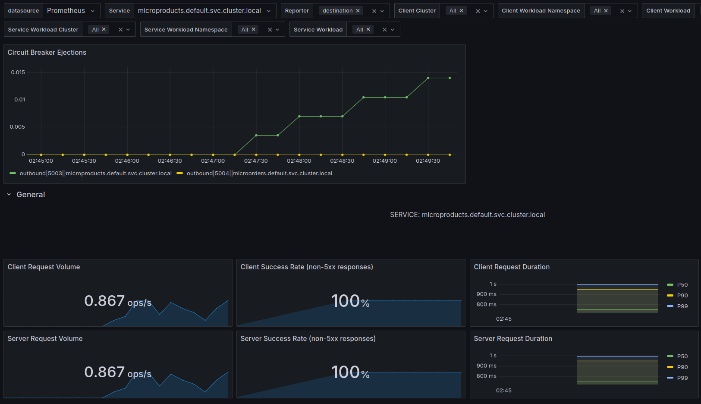
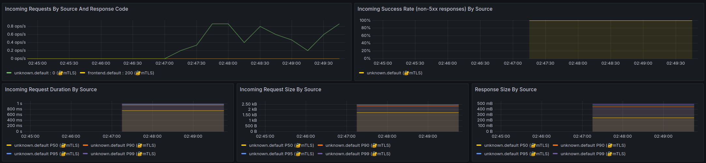
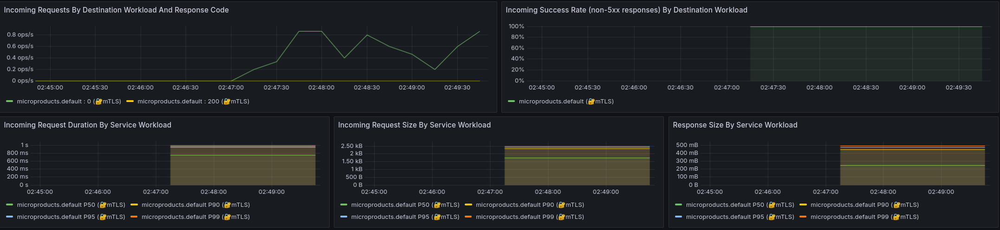

# Informe de Observabilidad y Análisis de Cuellos de Botella (R3.6 y R3.7)

**Proyecto:** Infraestructura resiliente con Kubernetes, Service Mesh y Chaos Engineering.

## Introducción
Este documento presenta el análisis de las trazas distribuidas (Jaeger) y los dashboards de métricas (Grafana) implementados para monitorear la aplicación. El objetivo es identificar cuellos de botella reales en la arquitectura y proponer mejoras basadas en datos.

---

## Requerimiento 3.6: Trazas Distribuidas con Jaeger

### 1. Metodología y Configuración

Para habilitar la observabilidad y el rastreo de peticiones *end-to-end* en la arquitectura de microservicios, se configuró la exportación de trazas distribuidas desde el Service Mesh (Istio) hacia **Jaeger** mediante la aplicación del recurso `Telemetry` (`k8s/07-telemetry.yaml`).

Con el propósito de simular un escenario real de degradación de rendimiento y validar la capacidad de diagnóstico de Jaeger, se inyectó una latencia artificial mediante un `EnvoyFilter` (`k8s/testing/98-envoy-fault-delay.yaml`) en el microservicio `microproducts`. Posteriormente, se generó tráfico sintético desde la interfaz web del frontend (`GET /products`).

### 2. Análisis del Cuello de Botella y Evidencia Experimental

El análisis conjunto entre la consola de red del navegador y la interfaz de Jaeger reveló la causa raíz del fallo de rendimiento:

#### A. Inspección en Consola de Red (Browser DevTools)

* **Comportamiento:** Las peticiones HTTP dirigidas al recurso `products` fallan de manera consistente devolviendo un código de estado `HTTP 504 Gateway Timeout`.
* **Tiempo de respuesta:** La latencia observada en las peticiones con error oscila entre **4,04 s y 4,14 s** (ej. 4047 ms, 4065 ms, 4101 ms, 4148 ms) antes de agotar el tiempo de espera del cliente.



#### B. Análisis de Trazas en Jaeger (Vista General)

* Al filtrar las trazas del servicio `frontend.default` con duración superior a 3 segundos, se identificaron múltiples trazas con duraciones coincidentes con los registros de red (**4.04s**, **4.06s**, **4.09s** y **4.12s**).
* Cada traza registra un total de **5 Spans** (1 span raíz en `frontend.default` y 4 spans en `microproducts.default`) junto con un indicador explícito de **5 Errores** (`5 Errors`).



#### C. Análisis Detallado en Vista Cascada (Waterfall) — Traza `01bada9`

Al examinar la traza `01bada9` (duración total: **4.12 s**), se observa la siguiente secuencia temporal:

1. **Span raíz:** Pertenece a `frontend.default`, abarcando toda la transacción (`4.12 s`).
2. **Spans de `microproducts` (Mecanismo de Reintentos R3.4):** Se observan **4 Spans consecutivos** para el servicio `microproducts.default` con las siguientes duraciones individuales:
   * **Intento 1:** `999.21 ms`
   * **Intento 2:** `999.68 ms`
   * **Intento 3:** `999.92 ms`
   * **Intento 4:** `999.90 ms`
3. **Diagnóstico técnico:** Cada intento es interrumpido casi de forma exacta al alcanzar los `~1000 ms` debido a la restricción del `perTryTimeout: 1s` configurado en Istio. La petición original falla por el retraso inyectado y activa los **3 reintentos automáticos**, acumulando los 4 intentos (`~4.12 s` en total) hasta que el proxy retorna el error `HTTP 504 Gateway Timeout`.



### 3. Propuesta de Mejora Documentada

#### Cuello de Botella Identificado

El microservicio `microproducts` (o el procesamiento de su capa de datos) introduce una latencia que excede el tiempo límite por intento (`perTryTimeout: 1s`). Esto activa en cascada la política de reintentos de Istio, multiplicando la carga sobre la red y resultando en la degradación total de la experiencia de usuario tras agotar el tiempo global de espera.

#### Propuestas de Mejora

1. **Capa de Caché en Memoria (Redis):**
   Implementar una instancia de Redis para almacenar en caché las respuestas del catálogo de productos. Dado que las consultas de productos son predominantemente lecturas, la respuesta se entregará en milisegundos evitando llamadas innecesarias al servicio y a la base de datos.

2. **Optimización de Base de Datos (`products-db`):**
   Ejecutar análisis de rendimiento (`EXPLAIN ANALYZE`) sobre las consultas SQL de productos y crear índices en las columnas utilizadas para filtrado y ordenamiento.

3. **Optimización de Código (Python):**
   Auditar el código fuente del microservicio `microproducts` para descartar problemas de consultas N+1, llamadas síncronas bloqueantes o procesamiento pesado de CPU en el hilo principal de la aplicación.

4. **Ajuste de Políticas en Istio:**
   Evaluar un balance entre `perTryTimeout` y la latencia nominal del microservicio para evitar bucles de reintento agresivos cuando el servicio dependiente experimenta degradación temporal.

---

## Requerimiento 3.7: Dashboard de Resiliencia en Grafana

### 1. Resumen de Configuración

Para la observabilidad del estado de resiliencia del clúster, se utilizó el **Istio Service Dashboard** oficial (`ID 7636`) en Grafana, al cual se le integró un panel personalizado para monitorear en tiempo real las expulsiones del **Circuit Breaker** mediante la consulta PromQL:

```promql
sum(rate(envoy_cluster_outlier_detection_ejections_enforced_total[5m])) by (cluster_name)
```

La configuración completa del dashboard se encuentra exportada y disponible en el repositorio (`k8s/grafana/istio-resilience-dashboard.json`). La validación del monitoreo se realizó inyectando fallos 503 en el microservicio `microproducts` mediante un `EnvoyFilter`.

### 2. Resultados Experimentales y Análisis de Métricas

#### A. Registro de Fallos en Cliente (Browser DevTools)



* **Observación:** Las solicitudes del cliente hacia la ruta `/products` fallan de manera continua devolviendo códigos `HTTP 504 Gateway Timeout`.
* **Impacto:** Se registra una acumulación sostenida de errores de tiempo de espera, lo que confirma que el servicio aguas abajo no está respondiendo dentro de los límites aceptables.

---

#### B. Monitoreo de Expulsiones del Circuit Breaker



* **Activación del mecanismo:** El panel personalizado registra una elevación inmediata en la tasa de expulsiones para el clúster objetivo (`outbound|5003||microproducts.default.svc.cluster.local`), alcanzando un pico máximo de **0.0138 expulsiones/segundo**.
* **Aislamiento de instancias:** La curva ascendente demuestra visualmente que el proxy Envoy de Istio detectó la tasa de errores y procedió a expulsar (*eject*) las instancias defectuosas. En contraste, los clústeres sanos (como `microorders`, representado en la línea amarilla) permanecieron invariables en `0`.

---

#### C. Telemetría de Peticiones por Origen (Incoming Requests by Source)



* **Volumen de tráfico:** Se observa una carga de solicitudes enviadas desde `frontend.default` con picos de hasta `0.8 ops/s`.
* **Perfil de latencia:** Los percentiles de tiempo de respuesta (p50, p90, p95 y p99) muestran una latencia base cercana a los `800 ms`, llegando a rozar el umbral de `1 s` previa activación de las reglas de corte por parte del Service Mesh.

---

#### D. Telemetría de Carga en Destino (Incoming Requests by Destination Workload)



* **Distribución de carga:** Se confirma la llegada de tráfico entrante a la carga de trabajo `microproducts.default`.
* **Comportamiento del servicio:** Los paneles de duración de peticiones y tamaño de respuesta (*Response Size*) reflejan los intervalos operativos antes de que el Circuit Breaker restrinja el flujo hacia los pods degradados.

### 3. Conclusiones

1. **Efectividad del Monitoreo:** El dashboard permite validar en tiempo real el comportamiento pasivo de autorrecuperación de Istio, evidenciando exactamente el momento en que las métricas de latencia y errores disparan el aislamiento de Pods via Circuit Breaker.
2. **Evidencia de Resiliencia:** Se logra aislar el impacto del microservicio afectado `microproducts`, previniendo un fallo en cascada hacia otros microservicios del sistema.
